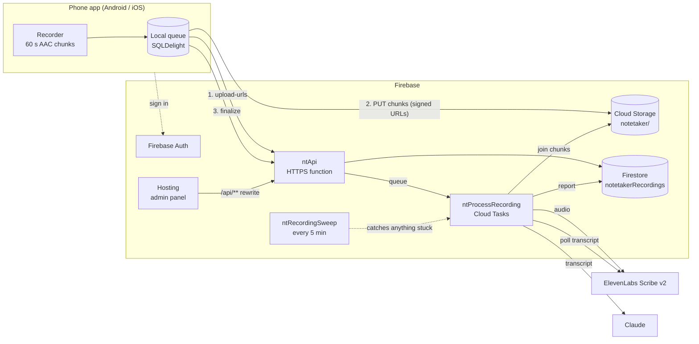

# AI Notebook

A daily AI notebook. Record a meeting, a lecture, a voice note or a journal entry on your phone. Within minutes of
stopping you get the full transcript with speakers and an AI written report shaped for that kind of note: a meeting
report with decisions and action items, study notes with flashcards and a quiz for a lecture, a clean note for a voice
memo, highlights for a journal. A web dashboard pulls everything together: stats, one task tracker for every action
item, an AI digest of your day or week, and a chat that answers questions about all your notes.

AI Notebook is a Generative AI course project. It has three parts:

| Part | What it is |
|---|---|
| **Phone apps** (`mobile/`) | Native Android and iOS apps that record long meetings reliably and upload them in the background |
| **Web app** (`admin/`) | Dashboard, notes with audio, transcript and AI report, task tracker, Ask AI chat, follow-up emails, PDF export and settings |
| **Backend** (`functions/`) | Firebase Cloud Functions that turn audio into a transcript (ElevenLabs Scribe) and the transcript into structured reports, tasks, digests and answers (Claude) |

## Try it

| | |
|---|---|
| **Web app** | https://ai-notebook-hs.web.app |
| **Android app** | [Download the APK](https://ai-notebook-hs.web.app/download/AI-Notebook.apk) (also in [Releases](https://github.com/Ishank5/ai-notebook/releases/latest)), open it on an Android phone and allow installing from this source |
| **iOS app** | Build from source with Xcode (see [Run the apps](#run-the-apps)) |
| **Test login** | Email `ishank@humblesolutions.in` · Password `12345678` |

The test login is an admin account already filled with demo notes (lectures, meetings, voice notes and journal
entries), so the dashboard, tasks, flashcards, quiz, mind map and Ask AI can be tried straight away. Record something
new on the phone with the same login and it shows up on the web within minutes.

## Contents

- [Try it](#try-it)
- [What it does](#what-it-does)
- [Where the Generative AI is](#where-the-generative-ai-is)
- [Architecture](#architecture)
- [How a recording becomes a report](#how-a-recording-becomes-a-report)
- [Tech stack](#tech-stack)
- [Repository layout](#repository-layout)
- [Data model](#data-model)
- [HTTP API](#http-api)
- [Setup](#setup)
- [Using the app](#using-the-app)
- [Limitations and next steps](#limitations-and-next-steps)
- [Credits](#credits)

## What it does

**On the phone**
- Sign in with email and password.
- Pick the planned length (1 h 30 m to 3 h) and the type of note (Meeting, Lecture, Voice note, Journal, Interview,
  Other), then tap Record.
- Recording keeps going with the screen off and the app in the background. Android shows an ongoing notification;
  iOS shows a Live Activity on the lock screen and Dynamic Island.
- At the planned length the phone beeps and asks; **Keep recording** adds time (up to 3 hours), otherwise it stops
  by itself after 5 minutes.
- Audio is saved on the phone in 60 second chunks and uploaded as it goes. No network, a phone call, the app being
  killed or the phone restarting does not lose the meeting: it waits on the phone and continues or uploads later.
- The **Meetings** tab lists your meetings with their status. Open one to read the AI report.

**In the web app** (https://ai-notebook-hs.web.app)
- **Dashboard:** notes this week, hours recorded, open and overdue tasks, an activity chart, note types, a mood trend,
  recurring topics, upcoming deadlines, recent notes, and an **AI digest** of today, this week or this month (themes,
  decisions, open questions, each linked to its notes).
- **Tasks:** every action item the AI found, in one tracker with your own tasks: tick off, edit owner, date and
  priority, filter, and see what is overdue, today, this week or later. Each AI task links to the moment it was said.
- **Notes:** every note with its type, search, date range and type filter. A note page has the audio player, the
  transcript (click a line to jump the audio there), the AI report as section cards, a **mind map**, a **talk time**
  chart per speaker and, for lectures, **study notes, flip flashcards and a quiz** with explanations and a score.
- **Follow-up email:** one click drafts the follow-up email with decisions and action items (formal or friendly), ready
  to copy or open in your mail app.
- **Export PDF:** a clean A4 report of any note.
- **Ask AI:** chat with all your notes or one note ("What did we decide about pricing?"); answers cite the notes and
  open them at the exact moment.
- Admins see everyone's notes and tasks, can re-run a note with another model or as another note type, retry or delete
  it, and change the default model. Members see their own.

## Where the Generative AI is

AI Notebook chains two generative models, then uses the LLM again on top of the results.

### 1. Speech to text: ElevenLabs Scribe v2

- The joined meeting audio goes to ElevenLabs Scribe (`scribe_v2`) with **speaker diarization**, **word level
  timestamps** and **audio event tags** (laughter, applause).
- The language is detected automatically, so Hindi, Punjabi or mixed meetings are transcribed as spoken.
- The request is asynchronous: the backend sends the audio, then polls ElevenLabs until the transcript is ready
  (after 5 s, every 5 s for the first minute, every 15 s up to 5 minutes, then every minute).
- The raw transcript is kept, and a tidied version is built from it: words grouped into speaker turns with start
  times.

### 2. Transcript to report: Claude (LLM)

- The tidied transcript, with `[mm:ss] speaker_0:` style turns, goes to **Claude Sonnet 5.5** by default. Admins can
  choose another Claude model (Opus 5.5, Haiku 5.5 and others) or an OpenAI model, and re-run any meeting with it.
- **Prompt design:** the system prompt sets the role (an assistant writing a meeting report), the rules (English
  output whatever language was spoken, nothing invented, empty fields when something was not discussed, timestamps
  taken from the transcript) and contains the **full JSON schema** of the report. The model must answer with JSON
  only.
- **Structured output:** the answer is parsed and checked against the schema loosely: unknown keys are dropped,
  missing lists become empty, enums fall back to safe values. A report always renders, even if the model drifted.
- **Timestamps as grounding:** every key point, decision, action item and question carries `at_seconds`, the moment in
  the meeting it came from, so the admin panel can jump the audio to the evidence.
- **Safety fallback:** if Claude declines a summary, the call is re-run on a fallback model within the same request.
- **Cost:** token usage and cost are stored with every summary and shown in the admin panel. Every summary is a
  direct, streamed call, so it is ready as soon as the model finishes.

### 3. Note types: one model, four prompts

The note type (from the phone, or picked by the model when the phone says Other) switches the instructions:

| Type | What the AI writes |
|---|---|
| Meeting | summary, key points, decisions, action items, questions, participants, issues, risks, next meeting |
| Lecture | study notes by heading, key terms with definitions, 8 to 12 flashcards, a 5 question quiz with explanations |
| Voice note | the note rewritten clearly, plus any tasks in it |
| Journal | highlights, a short reflection and the mood |

Every type also gets topic tags and a **mind map** (a tree of the main ideas, at most three levels deep) as part of
the same JSON answer.

### 4. LLM features across notes

- **Tasks:** action items from each report become tasks; due dates in words ("by Friday") are turned into dates from
  the meeting date.
- **AI digest:** Claude reads the reports of every note in a day, week or month and writes a digest with recurring
  themes, decisions and open questions, each pointing back to its notes. Cached until you refresh.
- **Ask AI:** a question is answered from your notes only. For one note the model reads its transcript; for all notes
  it reads the reports of your latest 60 notes. Answers must cite the note (and the moment); citations to notes you
  cannot see are dropped. If the notes do not say, it says so.
- **Follow-up email:** Claude drafts the email from the report in the tone you pick.

### The report schema

```jsonc
{
  "title": "Sprint planning for the mobile release",
  "summary": "3 to 6 sentences on what the meeting was about and what came of it",
  "how_it_went": "One or two sentences",
  "mood": "positive | neutral | negative | mixed",
  "mood_reason": "Why",
  "meeting_kind": "Team stand-up",
  "key_points":       [{ "text": "...", "at_seconds": 312 }],
  "decisions":        [{ "text": "...", "at_seconds": 845 }],
  "action_items":     [{ "task": "...", "owner": "...", "due": "...", "priority": "high | medium | low", "raised_by": "...", "at_seconds": 902 }],
  "questions_raised": [{ "question": "...", "raised_by": "...", "status": "open | answered", "answer": "...", "at_seconds": 1210 }],
  "participants":     [{ "name": "...", "role": "...", "stance": "...", "note": "...", "speakers": ["speaker_0"] }],
  "issues_raised":    [{ "area": "...", "topic": "...", "detail": "...", "severity": "high | medium | low", "raised_by": "...", "at_seconds": 1500 }],
  "commitments":      [{ "text": "...", "by": "...", "at_seconds": 1720 }],
  "opportunities": ["..."],
  "risks": ["..."],
  "next_meeting": "Thursday 10 am, demo of the new build",
  "future_scope": "...",
  "conclusion": "...",

  // every type
  "note_type": "meeting | lecture | voice_note | journal",
  "topics": ["Pricing", "Demo day"],
  "mind_map": { "center": "...", "branches": [{ "label": "...", "children": [{ "label": "...", "children": [] }] }] },

  // lecture
  "study_notes": [{ "heading": "...", "points": ["..."] }],
  "key_terms":   [{ "term": "...", "definition": "..." }],
  "flashcards":  [{ "front": "...", "back": "..." }],
  "quiz":        [{ "question": "...", "options": ["...", "...", "...", "..."], "answer_index": 1, "explanation": "..." }],

  // voice note / journal
  "note_body": "...", "highlights": ["..."], "reflection": "..."
}
```

The exact schema and system prompt are in [`functions/src/recording/summary/prompt.ts`](functions/src/recording/summary/prompt.ts).

## Architecture



- Clients never read Firestore or Storage directly. Everything goes through `ntApi`, which checks the Firebase ID
  token and the caller's role, and audio moves only through short lived signed URLs.
- API keys (Anthropic, ElevenLabs, OpenAI) live in Google Secret Manager and are bound only to the functions that
  need them. No key is in this repository or in any app.

## How a recording becomes a report

| Step | Where | What happens |
|---|---|---|
| 1 | Phone | Records AAC audio, cutting a new file every 60 s, each saved to a local queue |
| 2 | `ntApi` `upload-urls` | Creates the recording document and returns one signed upload URL per chunk |
| 3 | Phone | Uploads each chunk straight to Cloud Storage; retries later if offline |
| 4 | `ntApi` `finalize` | When the phone says it is done, checks every chunk is really in Storage, marks the recording `uploaded` and queues processing |
| 5 | `ntProcessRecording` | Joins the chunks into one `audio.aac` |
| 6 | `ntProcessRecording` | Sends the audio to ElevenLabs Scribe, then polls until the transcript is ready |
| 7 | `ntProcessRecording` | Stores the raw and tidied transcript in Storage |
| 8 | `ntProcessRecording` | Sends the transcript to Claude, validates the JSON report, stores it as a summary |
| 9 | Phone and admin panel | Status turns `ready`; the report shows in the Meetings tab and the admin panel |

Every step writes its progress to the recording's Firestore document first, so a retry continues where the last
attempt stopped. Errors are sorted: a provider that is busy is waited out, a wrong key or unreadable audio fails the
meeting with a clear message, and the admin can press Retry. `ntRecordingSweep` runs every 5 minutes as a safety net
for anything that stalled.

## Tech stack

| Area | Technology |
|---|---|
| Android app | Kotlin, Jetpack Compose, foreground service, MediaCodec AAC encoder |
| iOS app | Swift, SwiftUI, AVAudioEngine, ActivityKit (Live Activity) |
| Shared phone logic | Kotlin Multiplatform: recording queue (SQLDelight), upload and retry rules, planned length rules, models, strings |
| Admin panel | React 19, Vite, Tailwind CSS 4, React Router, lucide icons |
| Backend | Firebase Cloud Functions (Node 22, TypeScript), Firestore, Cloud Storage, Cloud Tasks, Cloud Scheduler, Secret Manager |
| Auth and hosting | Firebase Auth (email and password), Firebase Hosting |
| AI | ElevenLabs Scribe v2 (speech to text), Anthropic Claude (report), optional OpenAI |
| Design | Manrope typeface, pine teal and coral palette, custom waveform logo |

## Repository layout

```
gen ai project/
├── README.md
├── firebase.json            Functions codebase "ainotetaker", Hosting target "admin"
├── .firebaserc              Project team-akshay-sharma, site ai-notebook-hs
├── functions/               Backend
│   ├── src/api.ts             ntApi: the HTTP API
│   ├── src/recordings.ts      upload URLs, finalize, statuses
│   ├── src/recording/
│   │   ├── pipeline.ts        ntProcessRecording: join, transcribe, poll, summarise
│   │   ├── elevenlabs.ts      ElevenLabs Scribe calls
│   │   ├── transcript.ts      raw transcript to speaker turns
│   │   ├── summary/           prompt + schema, Claude and OpenAI clients
│   │   ├── read.ts            meeting list and detail
│   │   ├── admin.ts           settings, media links, retry/resummarise/delete
│   │   └── sweep.ts           ntRecordingSweep
│   ├── scripts/add-user.mjs   create or update a login
│   └── test/                  unit tests
├── admin/                   Admin panel
│   └── src/
│       ├── features/recordings/   list, detail (player, transcript, report), settings
│       ├── components/            app shell, logo, UI pieces
│       └── lib/                   API client, auth
├── mobile/                  Phone apps
│   ├── composeApp/            Android app
│   ├── iosApp/                iOS app (+ RecorderWidget Live Activity)
│   └── shared/                Kotlin Multiplatform shared code
└── design/                  Manrope font files, app icon renderer
```

## Data model

AI Notebook shares a Firebase project with an older, retired app, so all of its names are prefixed and nothing
overlaps.

| Where | Name | Holds |
|---|---|---|
| Firestore | `notetakerUsers/{uid}` | `name`, `email`, `role` (`admin` or `member`), `active` |
| Firestore | `notetakerRecordings/{id}` | owner, status (`uploading`, `uploaded`, `processing`, `ready`, `failed`), current step, duration, chunk counts, planned length, end reason, error, primary summary |
| Firestore | `notetakerRecordings/{id}/summaries/{id}` | one AI report: model, analysis JSON, token usage, cost |
| Firestore | `notetakerOps/settings` | default model |
| Firestore | `notetakerTasks/{id}` | one task: text, owner, due date, priority, done, source note and moment (AI or manual) |
| Firestore | `notetakerInsights/{uid}_{range}` | the cached AI digest for today, week or month |
| Storage | `notetaker/{id}/chunks/*.aac` | uploaded chunks (deleted after joining) |
| Storage | `notetaker/{id}/audio.aac` | the joined meeting audio |
| Storage | `notetaker/{id}/transcript.raw.json`, `transcript.json` | raw and tidied transcript |
| Functions | `ntApi`, `ntProcessRecording`, `ntRecordingSweep`, `ntElevenLabsWebhook` | codebase `ainotetaker`, region `us-central1` |

## HTTP API

Base URL: `https://us-central1-team-akshay-sharma.cloudfunctions.net/ntApi` (the admin panel uses `/api` on its own
origin through a Hosting rewrite). Every request sends `Authorization: Bearer <Firebase ID token>`.

| Method and path | Who | Purpose |
|---|---|---|
| `GET /api/me` | everyone | who is signed in, role, permissions |
| `POST /api/recordings/upload-urls` | everyone | signed upload URLs for chunks |
| `POST /api/recordings/finalize` | everyone | close a recording and start processing |
| `POST /api/recordings/statuses` | everyone | status of the caller's recordings |
| `GET /api/recordings` | everyone | meeting list (own; admins all) |
| `GET /api/recordings/:id` | everyone | one meeting with its summaries |
| `POST /api/recordings/:id/media` | everyone | audio link or transcript |
| `GET` / `POST /api/recordings/settings` | admin | read or change settings |
| `POST /api/recordings/test-model` | admin | check a model answers |
| `POST /api/recordings/upload-progress` | admin | upload progress of meetings still arriving |
| `POST /api/recordings/:id/action` | admin | retry, process early, resummarise (model, note type), set primary, delete |
| `POST /api/recordings/:id/email` | everyone | AI follow-up email for a note |
| `GET /api/dashboard` | everyone | stats, charts, topics, recent notes, upcoming tasks |
| `GET` / `POST /api/insights` | everyone | read or generate the AI digest (`range`: today, week, month) |
| `GET` / `POST /api/tasks`, `PATCH` / `DELETE /api/tasks/:id` | everyone | the task tracker |
| `POST /api/ask` | everyone | Ask AI over all notes or one note, with citations |

Refusals come back as `{ "error": "<key>", "code": "<key>" }` with an HTTP status, for example
`recordings.err.notFound`.

## Setup

### Prerequisites

- Node.js 22 or newer, the Firebase CLI (`npm i -g firebase-tools`), signed in with access to the Firebase project
- Android: Android Studio (JDK 17+ and Android SDK)
- iOS: Xcode 16+ and CocoaPods
- Secrets already set in the Firebase project: `ANTHROPIC_API_KEY`, `ELEVENLABS_API_KEY`, `ELEVENLABS_WEBHOOK_SECRET`,
  `OPENAI_API_KEY` (set any with `firebase functions:secrets:set NAME`)

### Config files (never committed)

| File | How to get it |
|---|---|
| `admin/.env.local` | copy `admin/.env.example`, fill in from `firebase apps:sdkconfig WEB 1:349120621558:web:dc738c967ec4bb44a8b5d7` |
| `mobile/composeApp/google-services.json` | `firebase apps:sdkconfig ANDROID 1:349120621558:android:a57dfe0ee2840479a8b5d7 -o mobile/composeApp/google-services.json` |
| `mobile/iosApp/iosApp/GoogleService-Info.plist` | `firebase apps:sdkconfig IOS 1:349120621558:ios:83536f44835d55b5a8b5d7 -o mobile/iosApp/iosApp/GoogleService-Info.plist` |

Add `--project team-akshay-sharma` to each command.

### Deploy the backend and admin panel

```bash
cd functions && npm install && cd ..
```

```bash
cd admin && npm install && npm run build && cd ..
```

```bash
firebase deploy --only functions:ainotetaker,hosting:admin --project team-akshay-sharma
```

The admin panel is then live at https://ai-notebook-hs.web.app.

### Create a login

Self sign-up is off. Create logins with a Firebase service account key (download it from Firebase console, Project
settings, Service accounts; keep it out of the repo). The script asks for the password in a hidden prompt.

```bash
cd functions && node scripts/add-user.mjs --key /path/to/service-account.json --email you@example.com --name "Your Name" --role admin
```

Use `--role member` for people who should only see their own meetings, `--deactivate` to turn a login off and
`--reset-password` to set a new password.

### Run the apps

- **Android:** `cd mobile && ./gradlew :composeApp:installDebug` with a phone connected, or open `mobile/` in Android
  Studio and Run.
- **iOS:** `cd mobile && ./gradlew :shared:generateDummyFramework`, then
  `cd iosApp && pod install` (run `export LANG=en_US.UTF-8 LC_ALL=en_US.UTF-8` first), open `iosApp.xcworkspace` in
  Xcode, pick a simulator or phone, Run.
- **Admin panel locally:** `cd admin && npm run dev`, then open http://localhost:5173. A dev proxy sends `/api` to the
  deployed `ntApi`.

### Tests

```bash
cd functions && npm test
```

## Using the app

1. Sign in on the phone with the login you created.
2. On the **Record** tab pick the planned length and the type of note (for a class, pick **Lecture**), then tap the
   record button.
3. Lock the phone and carry on. Pause or stop from the app, the notification (Android) or the Live Activity (iOS).
4. Tap Stop. The note uploads and moves to **Processing**; the screens refresh every few seconds.
5. As soon as it is ready it shows **Ready**. Open it in the **Meetings** tab for the report.
6. Sign in to the web app with the same login:
   - **Dashboard** for the week at a glance and the AI digest.
   - **Notes**, open the note: report, transcript, mind map, talk time; for a lecture, study notes, flashcards and the
     quiz. Use **Follow-up email** or **Export PDF** from the top of the page.
   - **Tasks** to tick off the action items the AI found, or add your own.
   - **Ask AI** to ask anything about your notes; click a citation to jump to that moment.

Debug builds have a fast test mode: long-press the "AI Notebook" title on the record screen and the planned lengths
shrink to minutes, so the warning and automatic stop can be tried quickly.

## Limitations and next steps

- Reports are in English; the transcript stays in the spoken language.
- Speaker names are labels (`speaker_0`, `speaker_1`); the report infers names from what people say.
- Logins are created by script; there is no sign-up or user management screen.
- The dashboard, tasks, Ask AI and other new features are in the web app; the phones record and show reports.
- Possible next steps: semantic search across all transcripts with embeddings, sending the follow-up email
  directly, calendar sync for task due dates, translating reports.

## Credits

Built on an AI notetaker originally developed at Humble Solutions. Manrope is by
Mikhail Sharanda, under the SIL Open Font License.
